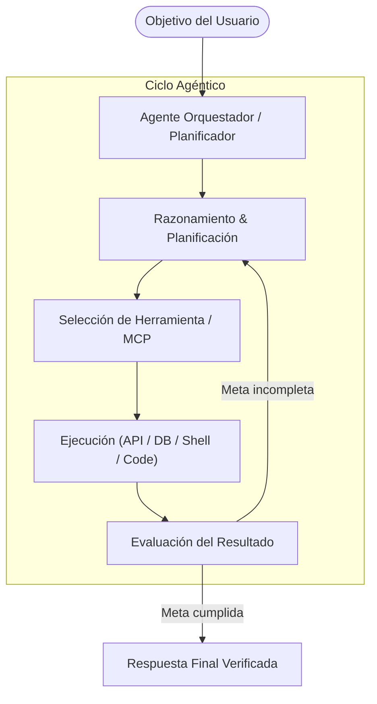

**Language / Idioma:** &nbsp;
 &nbsp;

# 🤖 AI Agentic Engineer

[⬅ Volver al Perfil Principal](../README.es.md) &nbsp;|&nbsp; [🧪 QA Automation SDET](./sdet.es.md) &nbsp;|&nbsp; [⚙️ Backend Developer](./backend.es.md)

---

## 📌 Visión & Enfoque de IA Agéntica
La evolución de la Inteligencia Artificial ha pasado de los prompts estáticos a **sistemas agénticos autónomos** capaces de razonar, planificar, utilizar herramientas y colaborar en equipo para resolver problemas complejos de ingeniería.

Como **AI Agentic Engineer**, diseño e implemento arquitecturas de agentes que interactúan con APIs, bases de datos y entornos de ejecución, incorporando mecanismos rigurosos de validación, evaluación de modelos y prevención de alucinaciones.

---

## 🛠️ Competencias & Áreas de Dominio

### 1. Arquitectura de Agentes & Uso de Herramientas (Tool Calling)
* **Model Context Protocol (MCP):** Integración de servidores y clientes MCP para conectar modelos de lenguaje con herramientas externas, sistemas de archivos, bases de datos y APIs empresariales.
* **Function Calling & Structured Outputs:** Definición de esquemas rigurosos (JSON Schema, Pydantic) para garantizar que las respuestas de los agentes sean deterministas y consumibles por código backend.
* **Flujos Agénticos (ReAct, Plan-and-Solve):** Implementación de bucles de razonamiento donde el agente descompone una meta en subtareas, ejecuta herramientas y evalúa el resultado antes de continuar.

### 2. Orquestación Multi-Agente
* Diseño de sistemas colaborativos donde múltiples agentes especializados (ej. Investigador, Auditor de Código, Ejecutor de Tests, Integrador) cooperan bajo una supervisión coordinada.
* Gestión de memoria a corto y largo plazo, ventanas de contexto y persistencia de estados conversacionales.

### 3. Retrieval-Augmented Generation (RAG)
* Construcción de pipelines de conocimiento contextualizado utilizando modelos de embeddings y bases vectoriales.
* Técnicas de fragmentación (chunking), re-ranking y recuperación híbrida para enriquecer las respuestas de los modelos con información veraz y trazable.

### 4. Evaluación & Benchmarking de Modelos de IA
* **Evaluación de Sistemas con LLMs:** Pruebas automatizadas sobre aplicaciones con modelos embebidos y fine-tuneados para medir:
  * Precisión fáctica y mitigación de alucinaciones.
  * Robustez ante inyecciones de prompt (*Prompt Injection*).
  * Adherencia a políticas de seguridad y principios de IA responsable.
* Pruebas de integración para asistentes virtuales y chatbots en entornos corporativos.

---

## 🏛️ Flujo de un Sistema Agéntico Autónomo

---

## 🎓 Credenciales & Google Cloud Badges
Especialización continua a través de programas oficiales de Google Cloud:
* 🏅 **Introduction to Generative AI**
* 🏅 **Introduction to Large Language Models (LLMs)**
* 🏅 **Generative AI Fundamentals**
* 🏅 **Introduction to Image Generation & Encoder-Decoder Architecture**
* 🏅 **Responsible AI: Applying AI Principles with Google Cloud**
* 🏅 **Google Cloud Computing Foundations: Data, ML, and AI in Google Cloud**

---

[⬅ Volver al Perfil Principal](../README.es.md) &nbsp;|&nbsp; [🧪 QA Automation SDET](./sdet.es.md) &nbsp;|&nbsp; [⚙️ Backend Developer](./backend.es.md)
