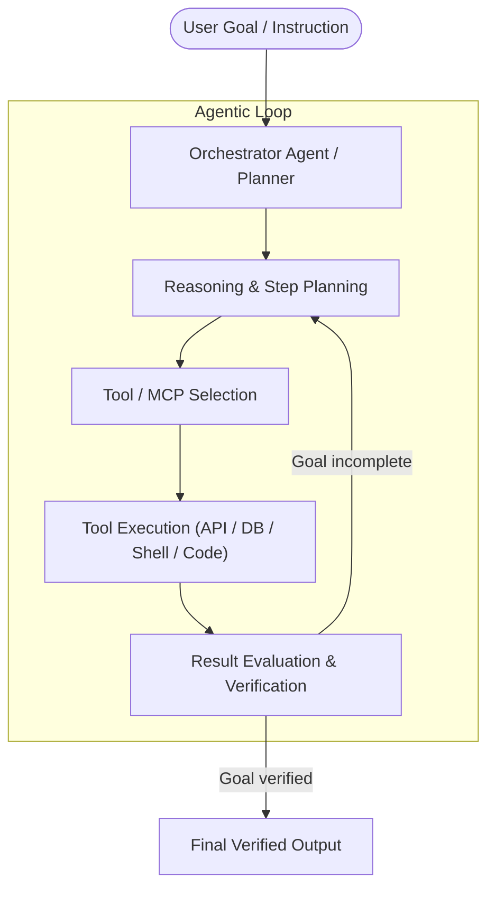

**Language / Idioma:** &nbsp;
 &nbsp;

# 🤖 AI Agentic Engineer

[⬅ Back to Main Profile](../README.md) &nbsp;|&nbsp; [🧪 QA Automation SDET](./sdet.md) &nbsp;|&nbsp; [⚙️ Backend Developer](./backend.md)

---

## 📌 Vision & Agentic AI Philosophy
The software engineering paradigm is rapidly evolving from static text generation to **autonomous agentic systems** capable of reasoning, planning, executing tools, and collaborating in teams to solve complex real-world tasks.

As an **AI Agentic Engineer**, I architect, build, and orchestrate intelligent agents that interact directly with APIs, databases, runtime sandboxes, and developer environments, while enforcing strict validation, model benchmarking, and hallucination prevention.

---

## 🛠️ Core Competencies & Domains

### 1. Agent Architecture & Tool Integration (Tool Calling)
* **Model Context Protocol (MCP):** Implementing and connecting MCP clients and servers to securely bind LLMs with external APIs, internal toolchains, databases, and filesystem resources.
* **Function Calling & Structured Outputs:** Enforcing deterministic schema validation (JSON Schema, Pydantic) to guarantee model outputs can be consumed safely by backend pipelines.
* **Agentic Reasoning Patterns (ReAct, Plan-and-Solve):** Implementing reasoning loops where agents decompose complex objectives into subtasks, execute tools, evaluate results, and iteratively adjust execution paths.

### 2. Multi-Agent Orchestration & Collaboration
* Designing specialized agent topologies (e.g., Coordinator, Researcher, Code Generator, Test Auditor) communicating through asynchronous message queues and stateful execution graphs.
* Implementing short-term context window management, persistent memory stores, and decision-gate checkpoints.

### 3. Retrieval-Augmented Generation (RAG)
* Building enterprise knowledge retrieval pipelines with semantic vector stores and dense embeddings.
* Applying advanced chunking strategies, cross-encoder re-ranking, and hybrid search to anchor LLM responses in verifiable ground truth.

### 4. AI Quality Assurance & Model Benchmarking
* **Automated LLM Evaluation:** Establishing automated test suites for embedded and fine-tuned models to measure:
  * Factuality, faithfulness, and hallucination rates.
  * Resilience against prompt injection and jailbreaks.
  * Adherence to enterprise safety boundaries and Responsible AI guidelines.
* Integration testing and telemetry for production AI chatbots and virtual copilots.

---

## 🏛️ Autonomous Agentic Execution Loop

---

## 🎓 Credentials & Official Google Cloud Badges
Continuous specialization verified by Google Cloud:
* 🏅 **Introduction to Generative AI**
* 🏅 **Introduction to Large Language Models (LLMs)**
* 🏅 **Generative AI Fundamentals**
* 🏅 **Introduction to Image Generation & Encoder-Decoder Architecture**
* 🏅 **Responsible AI: Applying AI Principles with Google Cloud**
* 🏅 **Google Cloud Computing Foundations: Data, ML, and AI in Google Cloud**

---

[⬅ Back to Main Profile](../README.md) &nbsp;|&nbsp; [🧪 QA Automation SDET](./sdet.md) &nbsp;|&nbsp; [⚙️ Backend Developer](./backend.md)
