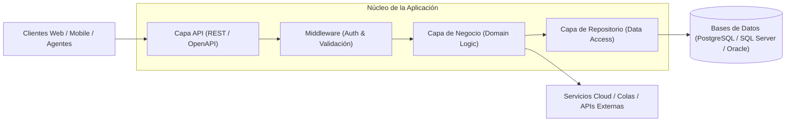

**Language / Idioma:** &nbsp;
 &nbsp;

# ⚙️ Backend Developer

[⬅ Volver al Perfil Principal](../README.es.md) &nbsp;|&nbsp; [🧪 QA Automation SDET](./sdet.es.md) &nbsp;|&nbsp; [🤖 AI Agentic Engineer](./agentic-ai.es.md)

---

## 📌 Visión & Filosofía de Backend
El desarrollo backend es la columna vertebral de cualquier sistema digital confiable. Mi enfoque combina una sólida formación en **Ingeniería de Sistemas** con principios de **Clean Architecture**, alta resiliencia y diseño enfocado en la seguridad y el rendimiento.

Construyo servicios desacoplados, bien documentados y testeables desde su concepción, capaces de procesar transacciones críticas y escalar con el crecimiento del negocio.

---

## 🛠️ Competencias Técnicas Clave

### 1. Lenguajes & Ecosistemas
* **Java:** Experiencia con el ecosistema de Java empresarial, gestión de dependencias con **Maven** y **Gradle**, aplicando estándares de codificación limpia, orientación a objetos sólida y concurrencia.
* **Python:** Desarrollo ágil de microservicios y utilidades con **FastAPI**, **Flask** y scripts de procesamiento de datos y orquestación.
* **TypeScript / Node.js:** APIs basadas en eventos, servicios asíncronos y tooling de backend modular.
* **C / Ensamblador:** Comprensión profunda de estructuras de datos a bajo nivel, memoria y arquitectura de sistemas computacionales.

### 2. Diseño & Arquitectura de APIs
* **RESTful APIs:** Diseño de endpoints basados en estándares OpenAPI/Swagger, versionamiento semántico, control de accesos mediante JWT / OAuth2 y manejo consistente de errores.
* **Integración de Servicios Legacy (SOAP):** Experiencia en entornos empresariales bancarios modernizando e integrando servicios SOAP basados en XML con arquitecturas REST modernas.
* **Principios de Diseño:** Aplicación rigurosa de principios **SOLID**, **DRY** y patrones de diseño (Factory, Strategy, Repository, Adapter).

### 3. Persistencia de Datos & Transaccionalidad
* **Bases de Datos Relacionales (SQL):** Modelado relacional, optimización de consultas, transacciones ACID e integridad referencial en:
  * **PostgreSQL**
  * **Microsoft SQL Server**
  * **Oracle Database**
  * **Sybase**
* Migraciones de esquemas de bases de datos, procedimientos almacenados y diseño de esquemas orientados a rendimiento.

### 4. Cloud & Entornos de Ejecución
* **Google Cloud Platform (GCP):** Computación, redes, infraestructura básica, gestión de almacenamiento y servicios de IA/ML (Certificado con Insignias Oficiales de Google Cloud).
* **AWS & Azure:** Despliegue y soporte de servicios sobre entornos cloud distribuidos, contenedores y pipelines de integración continua.
* **DevOps & Control de Versiones:** Git avanzado (GitFlow, Trunk-Based Development), integración continua con Jenkins, TeamCity y GitHub Actions.

---

## 🏛️ Enfoque Arquitectónico

---

## 💼 Experiencia en Sistemas Críticos
* **Core Bancario y Financiero:** Años de trayectoria en el sector bancario (Banco del Caribe) diseñando y validando transacciones financieras, protocolos de medios de pago e integridad de datos en arquitecturas bancarias de alta exigencia.
* **Servicios de Gestión & Gobernanza en EE.UU.:** Mantenimiento y desarrollo de backend para soluciones empresariales y herramientas de automatización.

---

[⬅ Volver al Perfil Principal](../README.es.md) &nbsp;|&nbsp; [🧪 QA Automation SDET](./sdet.es.md) &nbsp;|&nbsp; [🤖 AI Agentic Engineer](./agentic-ai.es.md)
