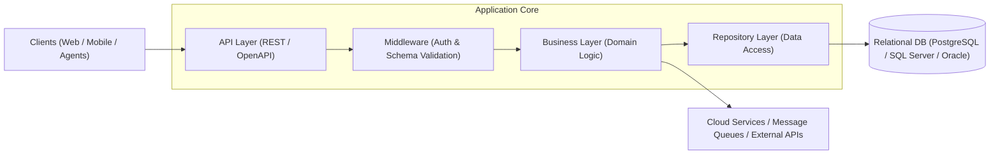

**Language / Idioma:** &nbsp;
 &nbsp;

# ⚙️ Backend Developer

[⬅ Back to Main Profile](../README.md) &nbsp;|&nbsp; [🧪 QA Automation SDET](./sdet.md) &nbsp;|&nbsp; [🤖 AI Agentic Engineer](./agentic-ai.md)

---

## 📌 Vision & Backend Philosophy
Backend engineering forms the bedrock of any reliable software ecosystem. My approach combines a rigorous background in **Systems Engineering** with principles of **Clean Architecture**, extreme resilience, and security-first engineering.

I design decoupled, testable, and strictly documented services capable of handling high-throughput transactional workloads and scaling gracefully alongside business demands.

---

## 🛠️ Key Technical Competencies

### 1. Languages & Ecosystems
* **Java:** Enterprise Java development, dependency lifecycle management via **Maven** and **Gradle**, enforcing clean code, robust object-oriented architecture, and multithreading.
* **Python:** Agile microservices, automation backends, and data tooling with **FastAPI**, **Flask**, and asynchronous Python frameworks.
* **TypeScript / Node.js:** Event-driven APIs, async microservices, and modular backend tooling.
* **C / Assembly:** Low-level foundation in computer architecture, memory allocation, and performance optimization.

### 2. API Design & Integration Architecture
* **RESTful APIs:** Designing predictable, contract-driven APIs following OpenAPI/Swagger standards, semantic versioning, JWT / OAuth2 authorization, and unified error handling.
* **Legacy Service Modernization (SOAP):** Deep experience across banking and enterprise infrastructures modernizing legacy XML-based SOAP services into lean RESTful APIs.
* **Design Principles:** Strict adherence to **SOLID**, **DRY**, and enterprise design patterns (Factory, Strategy, Repository, Adapter).

### 3. Data Persistence & Transactional Integrity
* **Relational Databases (SQL):** Schema design, index optimization, ACID compliance, and query performance across:
  * **PostgreSQL**
  * **Microsoft SQL Server**
  * **Oracle Database**
  * **Sybase**
* Automated schema migration tooling, stored procedures, and test data fixtures.

### 4. Cloud & Deployment Environments
* **Google Cloud Platform (GCP):** Cloud infrastructure, networking, secure storage, and integrated ML/AI services (Validated via Official Google Cloud Badges).
* **AWS & Azure:** Deploying and maintaining distributed services on containerized cloud environments and CI/CD automation pipelines.
* **DevOps & Version Control:** Advanced Git branching strategies, continuous integration with Jenkins, TeamCity, and GitHub Actions.

---

## 🏛️ Architectural Approach

---

## 💼 High-Stakes Systems Experience
* **Banking & Financial Core:** Years of experience at Banco del Caribe engineering and auditing critical transaction processing, payment protocols, and data recovery mechanisms.
* **Enterprise Governance & Legal Systems (US):** Backend infrastructure and automation services supporting management and compliance workflows.

---

[⬅ Back to Main Profile](../README.md) &nbsp;|&nbsp; [🧪 QA Automation SDET](./sdet.md) &nbsp;|&nbsp; [🤖 AI Agentic Engineer](./agentic-ai.md)
