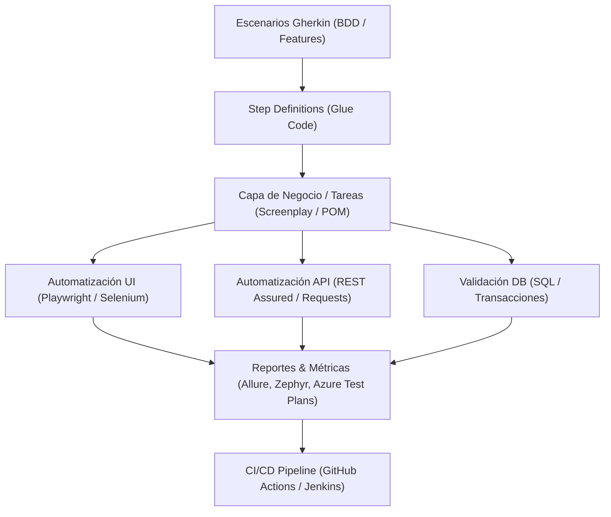

**Language / Idioma:** &nbsp;
 &nbsp;

# 🧪 QA Automation SDET

[⬅ Volver al Perfil Principal](../README.es.md) &nbsp;|&nbsp; [🤖 AI Agentic Engineer](./agentic-ai.es.md) &nbsp;|&nbsp; [⚙️ Backend Developer](./backend.es.md)

---

## 📌 Visión & Filosofía de Calidad
Como **Software Development Engineer in Test (SDET)**, concibo la calidad del software no como una fase posterior al desarrollo, sino como una disciplina transversal e integrada desde el primer día (**Shift-Left Testing**). Mi enfoque combina la ingeniería de software con arquitecturas de prueba automatizadas, robustas y mantenibles, asegurando entregas continuas de alta frecuencia sin comprometer la estabilidad en producción.

---

## 🛠️ Competencias Técnicas Clave

### 1. Frameworks de Automatización E2E & Web
* **Playwright (TypeScript / JavaScript):** Implementación de suites modernas con paralelismo nativo, trazabilidad visual (traces/videos) y soporte multiplataforma.
* **Selenium WebDriver (Java / C#):** Diseño de frameworks empresariales escalables basados en **Page Object Model (POM)** y **Screenplay Pattern**, gestionados con Maven y Gradle.
* **Cypress (JavaScript):** Pruebas de integración rápidas y confiables para aplicaciones web modernas.

### 2. Pruebas de APIs & Servicios Web
* **Automatización de APIs:** Pruebas funcionales, de contrato y regresión para servicios **REST** y **SOAP**.
* **Herramientas & Librerías:** Postman, Newman, REST Assured (Java), Requests (Python).
* **Validación de Datos en Backend:** Integración de pruebas automáticas con motores de bases de datos relacionales (**PostgreSQL, Microsoft SQL Server, Oracle, Sybase**) para verificar integridad transaccional y preparación de datos de prueba (test data management).

### 3. Metodologías BDD & TDD
* **Behavior-Driven Development (BDD):** Definición de escenarios de negocio ejecutables en lenguaje natural mediante **Cucumber** y **Gherkin**.
* **Test-Driven Development (TDD):** Pruebas unitarias y de componentes con JUnit, TestNG, NUnit y PyTest.

### 4. CI/CD & Calidad Continua (TestOps)
* Integración de suites automatizadas en pipelines de despliegue continuo con **Jenkins**, **TeamCity**, **Azure DevOps Pipelines** y **GitHub Actions**.
* Estrategias de ejecución distribuida y en contenedores (Docker / Selenium Grid / Cloud Providers).
* Monitoreo post-despliegue y pruebas de sanidad en ambientes de staging y producción.

### 5. Aseguramiento de Calidad para Sistemas de IA
* Diseño de casos de prueba y monitoreo continuo de plataformas impulsadas por inteligencia artificial: **AI-Chatbots**, asistentes conversacionales y aplicaciones generativas.
* Evaluación de comportamiento, manejo de contexto y precisión de respuestas en sistemas basados en LLMs.

---

## 🏛️ Arquitectura de un Framework de Pruebas Típico

---

## 💼 Experiencia Destacada en la Industria
* **Fintech & Banca (Banco del Caribe):** Liderazgo en el diseño de ambientes de certificación y automatización con Selenium, Java y Cucumber para servicios bancarios críticos y core bancario.
* **Ed-Tech (Stride K12 Inc.):** Arquitectura de suites automatizadas UI y backend integradas a pipelines de Jenkins sobre AWS, acelerando la entrega de sprints mediante SmartBear Zephyr y Jira Cloud.
* **AI Systems (Software Mind / Number8):** Control de calidad y pruebas automatizadas sobre plataformas con asistentes y chatbots potenciados por IA generativa en EE.UU.

---

[⬅ Volver al Perfil Principal](../README.es.md) &nbsp;|&nbsp; [🤖 AI Agentic Engineer](./agentic-ai.es.md) &nbsp;|&nbsp; [⚙️ Backend Developer](./backend.es.md)
