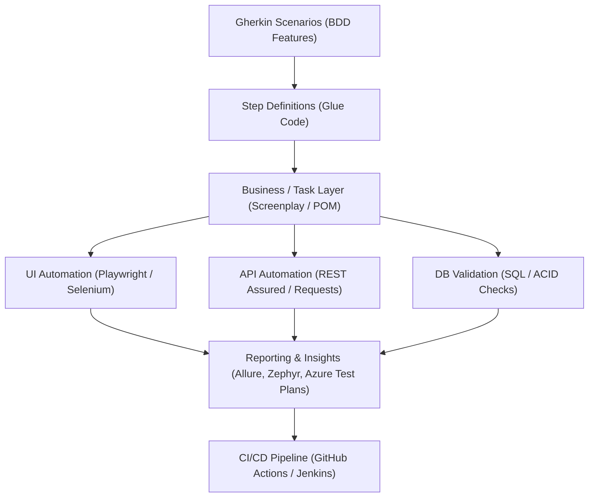

**Language / Idioma:** &nbsp;
 &nbsp;

# 🧪 QA Automation SDET

[⬅ Back to Main Profile](../README.md) &nbsp;|&nbsp; [🤖 AI Agentic Engineer](./agentic-ai.md) &nbsp;|&nbsp; [⚙️ Backend Developer](./backend.md)

---

## 📌 Quality Philosophy & Vision
As a **Software Development Engineer in Test (SDET)**, I view software quality not as a gatekeeping phase at the end of delivery, but as an engineering discipline baked into the entire lifecycle (**Shift-Left Testing**). My approach bridges core software engineering with resilient, maintainable automated test frameworks—enabling high-velocity deployments without sacrificing production stability.

---

## 🛠️ Key Technical Competencies

### 1. E2E & Web Test Automation Frameworks
* **Playwright (TypeScript / JavaScript):** Engineering modern test suites featuring native parallelization, deep visual traces, video recordings, and cross-browser coverage.
* **Selenium WebDriver (Java / C#):** Designing enterprise-grade, scalable frameworks using **Page Object Model (POM)** and **Screenplay Pattern**, managed with Maven and Gradle.
* **Cypress (JavaScript):** Fast, reliable component and integration testing for modern web apps.

### 2. API & Web Service Automation
* **API Testing & Contracts:** Functional, regression, and schema validation across **REST** and **SOAP** services.
* **Tooling & Libraries:** Postman, Newman, REST Assured (Java), Requests (Python).
* **Backend Data Verification:** Programmatic database hooks (**PostgreSQL, Microsoft SQL Server, Oracle, Sybase**) to validate data persistence, transactional integrity, and automated test data teardown/setup.

### 3. BDD & TDD Methodologies
* **Behavior-Driven Development (BDD):** Defining human-readable, executable specifications with **Cucumber** and **Gherkin**.
* **Test-Driven Development (TDD):** Rigorous unit and integration testing leveraging JUnit, TestNG, NUnit, and PyTest.

### 4. CI/CD & Continuous Quality (TestOps)
* Embedding automated test execution into CI/CD pipelines via **Jenkins**, **TeamCity**, **Azure DevOps Pipelines**, and **GitHub Actions**.
* Distributed test grid execution across containers (**Docker**, Selenium Grid, cloud device clouds).
* Automated health checks, smoke tests, and post-deployment verification.

### 5. Quality Assurance for AI Systems
* Designing test suites and real-time validation for generative AI applications: **AI Chatbots**, conversational agents, and autonomous assistants.
* Benchmarking LLM responses against safety guidelines, hallucinations, context grounding, and prompt drift.

---

## 🏛️ Reference Test Framework Architecture

---

## 💼 Industry Highlights
* **Fintech & Banking (Banco del Caribe):** Spearheaded IT quality certification environments and automation using Selenium, Java, and Cucumber for core banking transaction flows.
* **Ed-Tech (Stride K12 Inc.):** Architected automated UI and backend testing pipelines deployed on AWS and integrated with Jenkins, accelerating sprint velocity via SmartBear Zephyr and Jira Cloud.
* **AI Systems (Software Mind / Number8):** Automated testing and quality monitoring for AI-powered applications, chatbots, and corporate assistants in the US governance and legal software sectors.

---

[⬅ Back to Main Profile](../README.md) &nbsp;|&nbsp; [🤖 AI Agentic Engineer](./agentic-ai.md) &nbsp;|&nbsp; [⚙️ Backend Developer](./backend.md)
